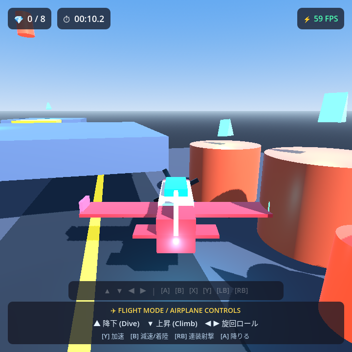

# RG Rotate 3D Test Game

Anbernic **RG Rotate**（3.5インチ 720×720 正方形液晶・十字キー＆物理ボタン搭載・スティック非搭載）に最適化した Godot 4 製 3D テスト用ゲームです。

<p align="center">
  
  <br />
  <em>実機（RG Rotate 720×720 / Mali-G52 MP2）にて安定 60 FPS 動作</em>
</p>

---

## 📖 開発ナレッジ・完全ガイド (GitHub Wiki)

本リポジトリで確立した技術知見（60 FPS レンダリング設定、スティックレス 3D 操作設計、物理ボタンの罠、乗り物システムなど）は、今後の別ゲーム制作でもそのまま活用できるよう **[GitHub Wiki](https://github.com/u1e2k/rg-rotate-3d-test/wiki)** に完全ドキュメント化しています。

| ドキュメント | 概要 |
|---|---|
| **[🏠 Wiki トップページ](https://github.com/u1e2k/rg-rotate-3d-test/wiki)** | ハードウェア仕様一覧と全体概要 |
| **[🕹️ 入力・操作設計ガイド](https://github.com/u1e2k/rg-rotate-3d-test/wiki/Controls-and-Keybindings)** | スティックレス 3D 操作設計、Y ダッシュ＋B ジャンプ、180°クイックターン、誤動作防止 |
| **[⚡ 60 FPS パフォーマンス最適化](https://github.com/u1e2k/rg-rotate-3d-test/wiki/Performance-and-60FPS-Tuning)** | Mali-G52 向け `gl_compatibility` (GLES3) 最適化、Glow 無効化、Filmic Tonemap |
| **[🎮 Godot 物理ボタン対応表](https://github.com/u1e2k/rg-rotate-3d-test/wiki/Godot-Button-Mapping)** | 実機キーと Godot 4 Joypad Index 完全対応表（`Start = 6` の罠、LB/RB） |
| **[🧩 ゲーム機能・アーキテクチャ](https://github.com/u1e2k/rg-rotate-3d-test/wiki/Game-Features-and-Architecture)** | 汎用 Interactable 設計、飛行機（Airplane）の 3D 物理、プロシージャル音響 |
| **[🤖 Android ビルド & ADB 手順](https://github.com/u1e2k/rg-rotate-3d-test/wiki/Android-Build-and-ADB-Workflow)** | ヘッドレスビルド、ADB 自動転送・起動、logcat リアルタイムデバッグ |

---

## 🎮 クイック操作リファレンス (Quick Controls)

### 通常時（徒歩モード）
- **十字キー (D-Pad)**: 前進・後退・左右旋回（カメラ自動追従）
- **Aボタン**: インタラクティブ（話す / 端末起動 / 飛行機に乗る）
- **Bボタン**: ジャンプ（Y ボタン同時押しでダッシュジャンプ）
- **Yボタン**: ダッシュ移動（Sprint）
- **RBボタン**: 弾丸発射（赤い標的ブロックを破壊可能）
- **LBボタン**: 180° クイックターン（瞬時に真後ろを向く）
- **Startボタン**: ポーズ設定メニュー（旋回感度・カメラ速度調整）
- **Selectボタン**: リセット / 初期位置へリスポーン

<p align="center">
  
  <br />
  <em>飛行機搭乗時の 3D フライト操縦画面</em>
</p>

### ✈️ 飛行機搭乗時（フライトモード）
- **十字キー 上 / 下**: 降下（ピッチダウン） / 上昇（ピッチアップ）
- **十字キー 左右**: 旋回＆バンク（ロール）
- **Yボタン**: フルスロットル加速（Boost）
- **Bボタン**: エアブレーキ減速（Brake）
- **RBボタン**: 2連装ブラスター発射（空中標的狙撃）
- **Aボタン**: 飛行機から降りる（降機）

---

## ⚙️ コントローラー設定画面 (Settings Modal)

<p align="center">
  
</p>

- **Startボタン** で開閉。
- 設定画面表示中は **ゲームが完全にポーズ** され、自キャラが勝手に動くことはありません。
- **Bボタンで閉じてもジャンプしない安全制御（入力抑制）** を実装。
- 設定した感度は `user://settings.cfg` に自動保存されます。

---

## 🚀 ビルド & 実機テスト (Quick Start)

### PC でのプレビュー実行
```powershell
godot --path .
```

### RG Rotate 実機へのビルド & デプロイ (ADB)
```powershell
# 1. デバッグ APK のビルド
godot --headless --export-debug "Android" build/rg_rotate_3d_test.apk

# 2. 実機へ転送・インストール
adb install -r build/rg_rotate_3d_test.apk

# 3. アプリ起動 (または端末ホーム画面のアイコンをタップ)
adb shell monkey -p com.anbernic.rgrotate.test3d -c android.intent.category.LAUNCHER 1
```

### 実機ログのリアルタイム確認
```powershell
adb logcat -s godot:*
```