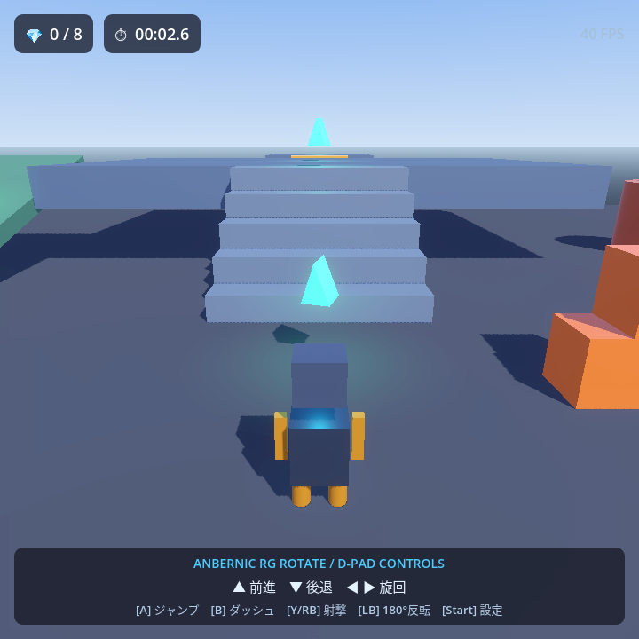
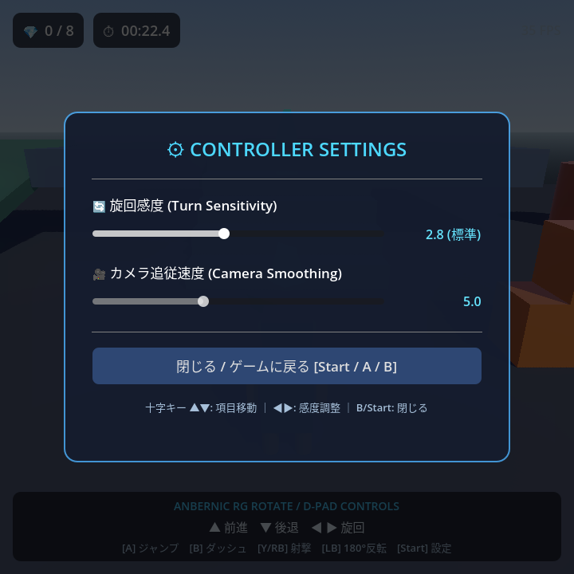

# RG Rotate 3D Test Game

Anbernic **RG Rotate**（3.5インチ 720×720 正方形液晶・十字キー＆物理ボタン搭載・スティック非搭載）に最適化したGodot 4製 3Dテスト用ゲームです。

<p align="center">
  
  <br />
  <em>実機（RG Rotate 720x720）での動作画面</em>
</p>

---

## 🎮 操作方法 (Controls)

本アプリは「**スティックが無くても快適に遊べる三人称視点（TPS）タンク/カメラ連動コントロール**」を採用しています。

| ボタン / キー | 動作 | 説明 |
|---|---|---|
| **十字キー 上 (▲ / ↑ / W)** | **前進 (Forward)** | 向いている正面へ前進。足踏みアニメーション＆足音。 |
| **十字キー 下 (▼ / ↓ / S)** | **後退 (Backward)** | ゆっくりと後ろ向きに歩行。 |
| **十字キー 左右 (◀ ▶ / ← → / A D)** | **旋回 (Turn Left / Right)** | 向きを変更。旋回時のバンク（体の傾き）演出付き。 |
| **Aボタン / Bボタン / Space** | **ジャンプ (Jump)** | 障害物や段差を跳び越えます。**Bボタンでのダッシュジャンプも快適に対応！** |
| **Bボタン / Xボタン / Shift** | **ダッシュ (Sprint)** | 高速ダッシュ移動。 |
| **Yボタン / RBボタン / Fキー** | **弾丸発射 (Shoot)** | 前方にエナジー弾を発射！物理ブロックに当たると勢いよく吹き飛ばせます。親指（Y）でも人差し指（RB）でも撃てます。 |
| **LBボタン / Qキー** | **180°クイックターン (Quick Turn)** | スティックのない携帯機で真後ろを即座に向き直せる快適機能。 |
| **Startボタン / Esc / Pキー** | **設定メニュー (Settings Menu)** | 旋回感度・カメラ追従速度を調整する設定画面を開閉。ポーズ機能付きで十字キーのみで操作可能。 |
| **Selectボタン / Rキー** | **リセット / リスポーン (Reset)** | 初期位置に戻ります（ステージ外へ落下した場合も自動復帰）。 |

---

## 📱 RG Rotate 向け設計ポイント

1. **720 × 720 正方形解像度**
   - 画面比率 1:1 に最適化されたHUDおよびカメラFOV設計。
   - スイベル構造（画面回転）時にも綺麗に収まるレスポンシブなUIレイアウト。
2. **物理十字キー（D-Pad）専用チューニング**
   - 上下キーで直感的な前進・後退。
   - 左右キーで適切な旋回速度（滑らかな回転補間）を適用。
   - 画面背後からプレイヤーを滑らかに追従する三人称カメラ（SpringArm3D + ダンピング補間）により、右スティックでの視点操作を一切必要としません。
3. **高視認性HUD & リアルタイム入力インジケーター**
   - 宝石カウント（💎）、経過時間（⏱️）、**高コントラストなフレームレート表示（⚡ 60 FPS）** を搭載。
   - 画面下部に **入力インジケーター（▲▼◀▶ [A][B][X][Y][LB][RB]）** を配置。押された物理ボタンがリアルタイムに明るく点灯します。
4. **3D物理・プラットフォームの動作テスト要素**
   - **高台と階段**: 床面から高台（高さ2.5m）へ5段で正確に接続された階段昇降テスト。
   - **スロープ（坂道）**: 床面から高台へ滑らかに登れる傾斜路。
   - **飛び石（フラット円柱）**: 安定して飛び乗れる3本の足場。
   - **動くリフト (Moving Platform)**: 高台から奥の離れ小島へ移動するリフト。
   - **押せる物理ブロック (RigidBody3D)**: 体当たりや射撃で吹き飛ぶブロックタワー。
   - **収集クリスタル (8個)**: 各所に配置された回転クリスタル。
5. **自己完結型プロシージャルサウンド**
   - 外部音声ファイルへの依存なしに、GDScript内部の `AudioStreamWAV` 合成により、ジャンプ音・コイン取得音・射撃音・着弾音・足音・着地音を生成・再生します。

---

## ⚙️ コントローラー設定画面 (Settings Modal)

<p align="center">
  
</p>

- **Startボタン** で開閉。
- 設定画面表示中は **ゲームが完全にポーズ** され、自キャラが勝手に動くことはありません。
- **Bボタンで閉じてもジャンプしない安全制御（入力抑制）** を実装。
- 設定した感度は `user://settings.cfg` に自動保存されます。

---

## 🚀 起動方法

### Windows PCでのテスト実行
```powershell
& "C:\Users\user\Downloads\Godot\Godot_v4.7.2-stable_win64_console.exe" --path .
```

### Android (RG Rotate 実機) へのインストール
```powershell
adb install -r ./build/rg_rotate_3d_test.apk
adb shell monkey -p com.anbernic.rgrotate.test3d -c android.intent.category.LAUNCHER 1
```